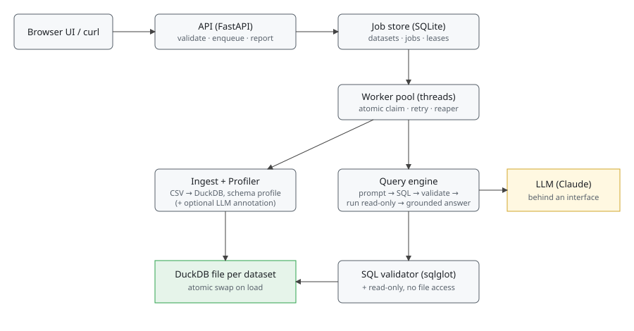

# System design

## Components and what each owns

| Component | Owns | Code |
|---|---|---|
| API | Input validation, status codes, structured errors, backpressure (429). Never calls the LLM or runs SQL. | `app/main.py` |
| Job store | Durable state machine `queued → running → succeeded / refused / failed`, leases, attempts, idempotency keys, dataset registry. | `app/jobs.py` |
| Worker pool | Atomic claim, retry of transient errors, reaping of jobs whose worker died. | `app/jobs.py`, `app/tasks.py` |
| Ingest | CSV to DuckDB, repeatable, atomic (temp file then rename). Fallback ladder for encoding and types. | `app/ingest.py` |
| Profiler | Measures columns (types, nulls, ranges, top values, negative share, text-that-is-really-dates). Knows nothing about the domain. | `app/profiler.py` |
| Query engine | Prompt from profile, SQL repair loop, execution, grounded narration. | `app/engine.py` |
| Chart picker | Chooses line / bar / scatter / histogram from column roles (time, measure, category) inferred from the result values; never from the question text. Skips scalars, truncated results and over-wide charts. | `app/charts.py` |
| LLM client | Structured output via tool use, behind a small interface so tests use a scripted fake. | `app/llm.py` |
| Validator | Static SQL checks (single SELECT, one table, no table/file functions). | `app/validator.py` |

## Path of a question

1. `POST /datasets/{id}/questions` validates the body, checks the dataset is `ready`, applies backpressure, enqueues, returns 202 + job id.
2. A worker claims the job in one transaction and holds a lease.
3. The engine renders the stored profile as prompt context. Only the profile is used; no dataset-specific text exists in code.
4. The LLM returns `{answerable, reason, sql, assumptions}`. `answerable=false` becomes a `refused` job.
5. The SQL is statically validated, then run on a **read-only DuckDB connection with external file access disabled**, a timeout (interrupt) and a row cap.
6. If validation or execution fails (e.g. an invented column), the error is returned to the model for up to 3 attempts, then the job is `refused`, not guessed.
7. The LLM narrates the rows; a check requires every number in the text to trace to a result value (rounded, %, K/M/B, ranks). If not, a plain deterministic summary is shown and `answer_verified=false`.
8. A chart spec is chosen from the result's shape (`app/charts.py`, no LLM call) and attached as `chart`; it is `null` when a table is the better view.
9. The result carries answer, SQL, assumptions, rows, chart and token usage. Clients poll `GET /jobs/{id}`.

## Schema context from an unfamiliar file, and where it breaks

DuckDB's sniffer infers delimiter, header and types. Headers are normalised to SQL-safe names. If loading fails the ingest retries with latin-1,
then all-text, then lenient. The profiler then measures every column and writes hints such as "text dates in format `%m/%d/%Y %H:%M`" or
"text that mostly looks numeric but contains `C536379`". If an API key is set, one LLM call at ingest adds *unverified* role/metric hints
(for example revenue = quantity * unit price); failure there is non-fatal.

Breaks, honestly:
- Ambiguous day/month dates are flagged, not resolved.
- Revenue definitions are guessed from names and values; the answer states its assumption but a wrong guess is possible.
- Single-table only. Multi-file or star-schema data is not modelled.
- Wide tables (hundreds of columns) will bloat the prompt; no column pruning yet.
- Currency symbols or locale decimals ("1.234,56") are only handled if the file falls back to text and the model casts them.
- Non-UTF8 encodings other than latin-1 and UTF-16 fail.

## Biggest decisions and rejected alternatives

1. **LLM-written SQL, constrained, instead of templates or a fixed semantic layer.** Templates cannot cover an unseen CSV. Cost: correctness depends on the model, so defence is layered: prompt rules, static validation, read-only connection, repair loop, refusal, grounded narration and an eval suite.
2. **DuckDB instead of Postgres/SQLite/Snowflake/pandas.** Zero-ops, runs from `pip install`, CSV sniffing, fast aggregates, and a read-only no-file-access mode. Rejected: Postgres (type inference is on us, more setup), Snowflake (needs an account, breaks clean-machine setup), pandas (would mean executing model-written code). Cost: single writer; one file per dataset avoids contention.
3. **SQLite job table with in-process worker threads instead of Celery/Redis.** One command to run and still durable. Claim is atomic; expired leases are requeued; exhausted jobs fail with a stable code. Cost: single host. Next step is Postgres `SKIP LOCKED` or a managed queue; the `Store` interface is the seam.
4. **Refuse rather than answer.** `refused` is a first-class terminal status distinct from `failed`. The model may decline up front, or is declared unable after failed repairs. Cost: some answerable questions get refused; measured by the eval.

## Concurrency and partial failure

- Claims are atomic, so two workers never run one job (tested with 8 racing threads).
- A dead worker's lease expires and the job is requeued up to `MAX_ATTEMPTS`, then fails as `worker_lost`.
- Transient LLM errors (429/5xx/connection) retry with backoff; auth/config errors fail immediately with a stable code.
- Ingest writes to a temp file and renames, so a half-loaded dataset is never queryable. A failed ingest marks the dataset `failed`.
- Reads use separate read-only connections, so questions run in parallel. Idempotency keys make client retries safe. A full queue returns 429.
- Gap: the lease is not heartbeated, so a job longer than `LEASE_S` could be requeued while still running.

## Evaluation and guardrails

`evals/*.yaml` hold questions with reference SQL written independently of the app and unanswerable questions that must be refused.
`python -m evals.run <suite>` prints pass/fail, correct refusals and tokens. A question passes if every reference value appears in the result.
Unit tests (LLM faked) cover the validator against adversarial SQL, both safety layers independently, the repair and refusal paths,
numeric grounding, ingest oddities, the job state machine and API error shapes.

**Not yet verified:** the live-LLM evals have not been run in this repo because no API key was available when it was built. Run them before trusting accuracy claims.

## What I cut

SSE streaming (polling only), auth (out of scope), lease heartbeats, column pruning for wide tables, an editable semantic layer.

Built since the first cut: result caching, follow-up questions, charts, and LLM tracing (LangSmith).

## What I would build next, in order

1. Run and tune the live evals; add a suite for each CSV shape the panel is likely to bring.
2. Editable semantic layer: persist and let a human correct the inferred metrics and roles per dataset.
3. Lease heartbeats and a Postgres-backed queue for multi-host workers.
4. Result caching keyed on normalised SQL, so differently-worded questions that produce the same query share an answer.
5. Optional model hint for the chart type when the shape heuristics are ambiguous.

## Where a new feature would land

- New metric or business rule: profile annotations (`profile["annotations"]`), rendered in `profile_to_text`.
- New output (export, another chart type): a renderer after step 5 in `engine._finish`; no change to jobs or API shape. Charts live in `app/charts.py` (choice) and `app/static/index.html` (drawing).
- New data source (Postgres, Snowflake): implement the load/profile/execute-readonly trio behind `ingest.py` and `engine.run_readonly`.
- Auth or multi-tenancy: middleware in `main.py` plus an owner column on `datasets`.
